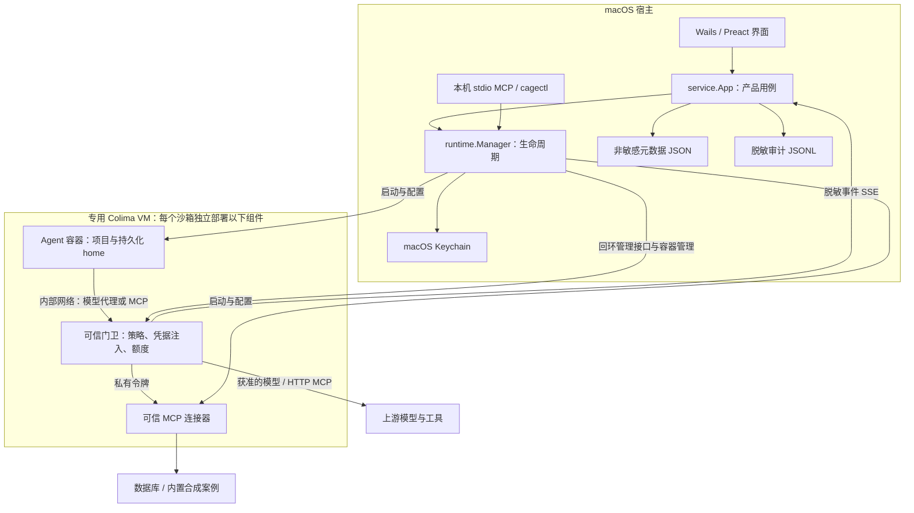
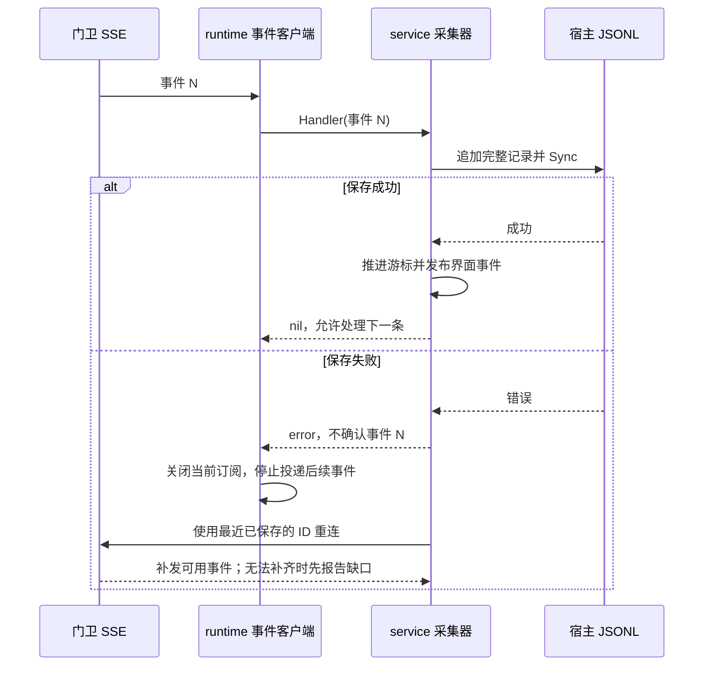

# Ai of Cage 当前架构

[文档目录](README.md) · [开发指南](development.md)

本文对应 2026-10-25 的代码实现。产品规则见[工作区规格](product-workspace.md)，各轮实测范围见[验收记录](validation/README.md)；原始设计过程保留在 [v3 设计草案](architecture.md)。

## 产品与部署

Ai of Cage 是本地智能体工作区。用户保存多个供应商配置，在每个沙箱中为 Codex、Claude Code、DeepSeek Harness 分别选择供应商；智能体处理被挂载的项目，通过受控出口调用模型和 MCP。桌面会话由用户手动选择供应商，本机 MCP 控制任务可显式配置备用供应商。

宿主运行一个 Go/Wails 桌面进程，不增加常驻宿主服务。容器运行在专用 Colima profile `aiofcage`，所有 Docker 命令显式指定 context `colima-aiofcage`。默认 VM 为 4 核、6 GiB 内存、40 GiB 磁盘，可在设置中调整；仅共享 `~/CageWorkspace`。

图中箭头表示调用或数据方向；实际依赖由下面的模块表限定。前端和本机控制入口均不获得上游密钥。

## 模块职责

| 模块 | 责任与边界 |
| --- | --- |
| `frontend/src` | 沙箱、供应商、会话、MCP、日志、用量和运行状态。通过 Wails 调用产品接口；不直接调用 Docker 或读取 Keychain。 |
| `service` | 产品用例、配置校验、桌面会话、审计采集、用量投影。AI 解说只解释脱敏元数据，不参与授权。 |
| `runtime` | 专用运行环境、镜像、网络、容器、进程和运行配置；桌面、命令行和本机 AI 控制共用，不回退到宿主执行智能体。 |
| `store` / `filelock` | 原子保存非敏感配置，协调多进程的元数据和生命周期操作。 |
| `vault` / `oauth` | Keychain 持久化、宿主授权与续期。刷新令牌不下发给智能体。 |
| `provider` / `sandbox` / `mcp` | 供应商、沙箱与工具配置及其校验；保存的选择与已应用配置分开记录。 |
| `gatekeeper` / `policy` | 执行网络策略、占位凭据校验、上游凭据注入、额度与工具权限；默认拒绝。 |
| `connector` | 运行固定目录中的可信工具服务，代持数据库凭据；拒绝项目提供的任意启动命令。 |
| `audit` / `events` | 定义脱敏事件与可确认的订阅契约，接收方保存失败时中断投递。 |
| `control` | 本机 stdio MCP 协议，无网络监听；每个控制会话只能操作自己创建的沙箱。 |

新增能力应进入相应模块；界面层不维护第二套容器状态机，统计页不自行向模型探活。

## 沙箱重置与恢复

沙箱的配置元数据、项目目录和运行对象分开管理。用户执行“重置运行环境”时，`runtime.Manager.Reset` 会先保存当前用量，清空门卫策略，删除可信 MCP 连接器并清理宿主内存中的连接器令牌，再停止并删除 Agent、门卫、网络和连接器对象。项目目录不会被触碰；Agent home 数据卷按用户选择保留或删除。

重置成功后会清除已应用配置快照，下一次启动重新从保存的供应商绑定、MCP 服务、工具权限、额度和版本配置构建。对运行中的沙箱，界面默认勾选“重置完成后恢复运行”，重置完成后复用普通启动流程；用户也可以只重建并保持停止。任一步拆除或重建失败都会保留沙箱元数据，并把错误交给操作状态和前端通知展示。重置会结束桌面结构化会话，原生 CLI 的历史是否保留取决于是否保留 Agent home。

## 三条隔离边界

| 边界 | 实施机制 | 保留的能力与限制 |
| --- | --- | --- |
| 文件 | VM 共享目录校验；每个 Agent 只挂载选定项目和自己的 home；非 root、只读根文件系统、去除 capabilities、禁止获得新权限。 | 项目可写，智能体可以修改或删除项目文件。Agent 仍可读容器本身的系统文件；容器内执行命令不等于逃逸。 |
| 网络 | 每个沙箱独立内部网络；Agent 不接出网网络；门卫按域名、端口、方法、路径和服务权限决定是否转发。 | 门卫与可信连接器具有上游访问能力，属于可信组件。未知目标默认拒绝，不自动重放被拒请求。 |
| 凭据 | 秘密持久化在宿主 Keychain，宿主传输时短暂持有，门卫和连接器按需在运行期持有；Agent 只得到模型占位符及受限的内部 MCP 凭据。 | 已授权服务仍可能被滥用；隐藏上游密钥不能代替工具最小权限和额度。 |

模型请求由门卫校验占位符后替换请求头。所有 MCP 服务都经门卫的 MCP 入口（8890）访问：数据库和内置案例转给可信连接器；远程 HTTP/OAuth 服务由门卫加上令牌后，用代理同一套只连公网、校验证书、不跟随跳转的传输转发，代理不为它们放行，也不持有它们的令牌。门卫逐条严格解析 JSON-RPC 消息，重复的键或与已知键名只差大小写（含 Unicode 折叠）的键一律拒绝，避免门卫和上游读出不同的方法或工具名。沙箱为每个服务保存工具 allowlist，门卫在 `tools/call` 入口强制执行，并从 `tools/list` 回复中去掉未授权的工具；显式空列表表示服务启用但所有工具均拒绝。连接器的工具由 AIofCage 固定，旧沙箱没有该字段时继续使用连接器目录默认工具。远程服务的工具清单由宿主按 MCP 协议获取，默认只授权服务标注 `readOnlyHint` 的工具，授权一旦确定就固定保存，服务之后新增的工具需要用户勾选；远程服务的资源和提示词不开放。PostgreSQL 连接器使用专用只读账号、有效权限检查和 SQL AST 策略，拒绝多语句、文件与程序能力。数据库密码不进入 Agent。

OAuth 凭据只保存在宿主钥匙串；连接和刷新都在宿主完成，门卫只收到短期 access token。用户断开本机授权时删除本地凭据并刷新使用该服务的运行沙箱；若上游没有提供可用的撤销端点，外部服务侧授权需要用户在服务方另行撤销。

这套边界不承诺抵御容器、VM 或宿主内核漏洞，也不把有限探针结果推广为所有攻击的证明。

## 生命周期与配置一致性

沙箱的创建只保存配置。启动时准备镜像、网络与可信组件，向门卫下发策略和运行期秘密，再启动 Agent 并写入占位配置。失败时尝试停止相关容器。停止或撤销 MCP 权限时先向门卫下发空策略，删除可信连接器并清理宿主内存中的连接器令牌，再停止 Agent 和门卫；项目目录与 Agent home 保留。

供应商绑定、模型与智能体版本区分“已保存”和“本次运行已应用”。更改绑定不会把旧会话悄悄切到另一供应商，重启后应用。增装和更新先准备候选镜像，替换失败尝试恢复原配置；项目和 home 卷保留。

同一沙箱的生命周期操作通过进程内互斥及跨进程文件锁串行化；环境锁协调启动、镜像替换和停止 VM，防止另一进程在检查空闲后同时启动任务。版本由镜像内容摘要和沙箱版本快照约束。

结构化会话启动前可以运行不产生模型请求的链路诊断，检查运行环境、已应用供应商、钥匙串凭据、门卫和会话桥接组件。智能体退出时只保留有限的标准错误尾部，并在展示前移除已知凭据；认证失败、限流、超时和网络失败会转换为用户可执行的提示。

## 审计、用量与恢复

门卫是策略执行和请求事件的来源。桌面采集器订阅 SSE，把事件写入每个沙箱的 JSONL 日志；日志页、按请求用量和费用估算消费这份脱敏记录。采集器不改变门卫的放行判定。

安全诊断中心读取同一套运行状态、MCP 权限和脱敏事件，集中展示文件共享、网络出口、凭据持有者、审计边界、门卫就绪状态和最近拒绝次数；隔离检查结果只代表最近一次主动探针，不能替代完整安全审计。诊断界面不参与放行决定。

日志页按沙箱、决策类型和事件时间展示审计时间线，并可导出最近保存的脱敏事件 JSON。导出的内容沿用 `audit.Event` 字段约束，不包含请求正文、请求头、MCP 参数、结果或凭据。

关键约束：

1. **保存成功才确认。** 只有 JSONL 写入并 `Sync` 成功，才更新内存游标和发布界面事件。失败后不消费后续记录，避免下一条成功记录越过未保存的事件。
2. **保留完整游标。** 重连始终携带最近保存的 `<run_id>:<seq>`。门卫运行已变化时，由服务端先发 `audit.gap / cursor_from_other_run`；客户端不提前清空旧游标。
3. **读取失败不表示没有历史。** 无法读取日志或恢复游标时报告中断并重试，不把错误转换为空历史。日志文件不存在才表示还没有记录。
4. **传输至少一次，统计按事件去重。** 重连或写入结果不确定时允许重复记录，不宣称恰好一次。统计把缺口和普通请求分别去重，防止相同游标 ID 隐藏缺口或漏算请求。
5. **保留崩溃痕迹。** 发现日志末尾没有换行时，先补分隔再追加，保留残行；无效 JSON 行在用量查询中计入缺口，不吞掉下一条完整记录。
6. **异常不静默。** 非 SSE、无效事件、接收方失败都终止当前订阅并触发重连提示；恢复后以普通通知提示，不使用错误样式。格式错误的事件原文不进入通知。

| 情况 | 实际行为 |
| --- | --- |
| 短时断线或磁盘写入失败 | 从最近确认的事件恢复；窗口内可补发的事件重新写盘。 |
| 门卫运行已变化 | 先记录跨运行缺口，再继续新运行的事件。缺口提示可能丢失的范围，不代表已找回旧事件。 |
| 采集落后超过门卫缓冲 | 最近 1,000 条以内补发，超出部分明确标记 `buffer_overflow`。 |
| 本地日志损坏 | 保留原字节；查询提示无效行，完整新记录继续独立保存。 |
| 正常取消订阅或应用退出 | 关闭订阅，不产生误导性的故障恢复提示。 |

累计请求/token 额度由门卫执行，宿主保存累计基线；按请求的费用估算使用事件中的历史价格快照。缺价格、未知用量与日志缺口分别呈现，不补造金额，不混加币种，也不等同供应商账单。

## 可观测性与开销

运行监视每 5 秒批量采样容器状态与资源；CPU/内存趋势最多保留 120 个点，最近事件缓存最多 500 条。未配置健康检查、采样失败、API 不可达与容器未运行分别展示，不使用计费模型请求作为周期探活。

前端使用随包固定的 Preact、htm 和 xterm.js，没有新增构建链。每个沙箱需要 Agent、门卫，按启用服务增加连接器；主要资源开销来自 VM、实际智能体任务和镜像。本文不把容器资源上限当作实际占用量。

## 当前限制与后续方向

- 审计由桌面监视器采集。桌面关闭期间，门卫只有有界内存补发能力；本机 AI 控制模式尚未拥有独立的持久审计采集器，不能承诺离开桌面仍有完整的逐请求明细。
- JSONL 没有防篡改保证，未记录命令、请求正文、MCP 参数与结果，也没有日志轮转或历史查询索引。后续应根据实际日志规模补充归档和索引。
- 应用内结构化消息正文仍只保存在当前进程，重启后不会恢复历史正文；应用会持久化沙箱、智能体、供应商、模型、思考强度和原生 session ID，用于列出可恢复会话。恢复要求沙箱和会话组件可用，供应商配置变化时拒绝续接；主动关闭或删除沙箱会清理恢复记录。原生 CLI 历史仍留在 Agent home。
- 远程 MCP 只支持 streamable HTTP；门卫对 GET 回 405，不提供服务端推送，工具列表变化要在应用里重新测试连接后才可勾选。只读标注来自服务自身，门卫只按工具名放行，不检查参数；GitHub、Notion、Linear、Sentry 的真实账号尚未逐项验证，见[远程 MCP 验证](validation/2026-10-30-remote-mcp-gateway.md)。
- 桌面会话不自动切换供应商；本机 MCP 的 `run_task` 可显式指定最多三个同 Agent 备用供应商，失败后停止当前沙箱、切换绑定并重新执行任务。没有自动回滚项目修改、跨沙箱任务编排或逐命令审批。

安全诊断中的四项边界是配置说明，不能当作实际探针通过结果；最近隔离检查保存在当前应用进程的内存中。审计时间线导出复用 `RecentEvents`，最多包含该沙箱最近 300 条事件，写入用户私有的 JSON 快照并覆盖同名文件；完整历史仍使用原始 JSONL。

恢复链路的可复现检查见[审计恢复验证](validation/2026-10-25-audit-recovery.md)，其他专题见[验收记录索引](validation/README.md)。
